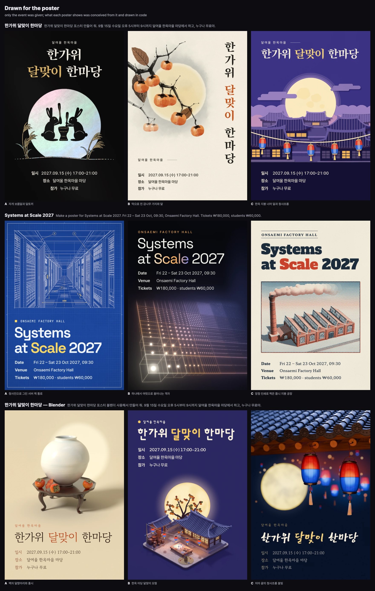
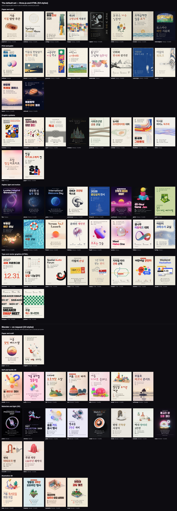
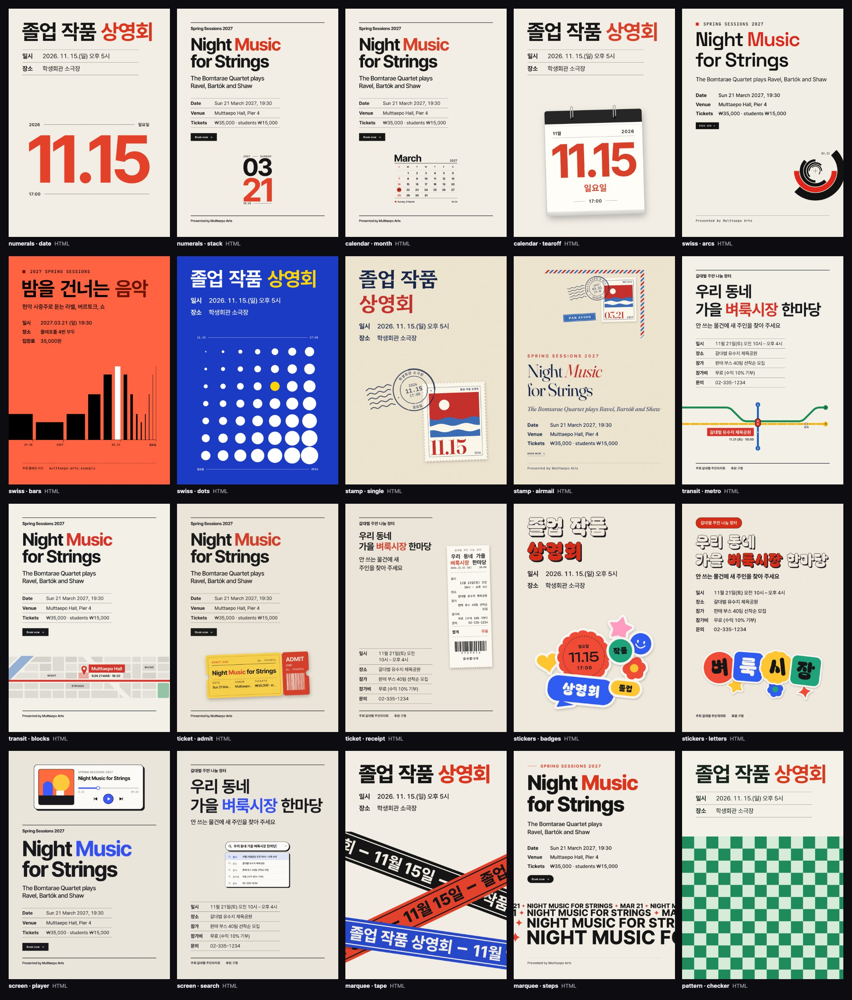
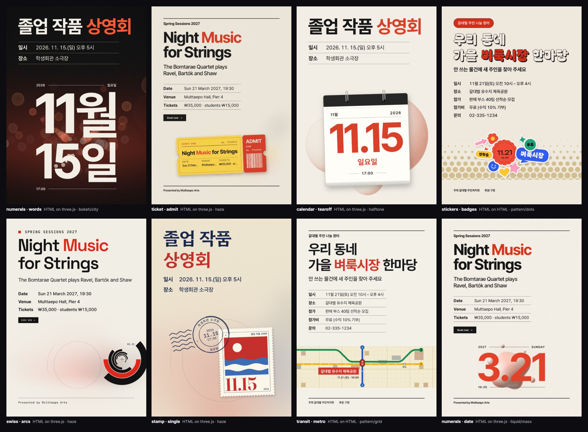
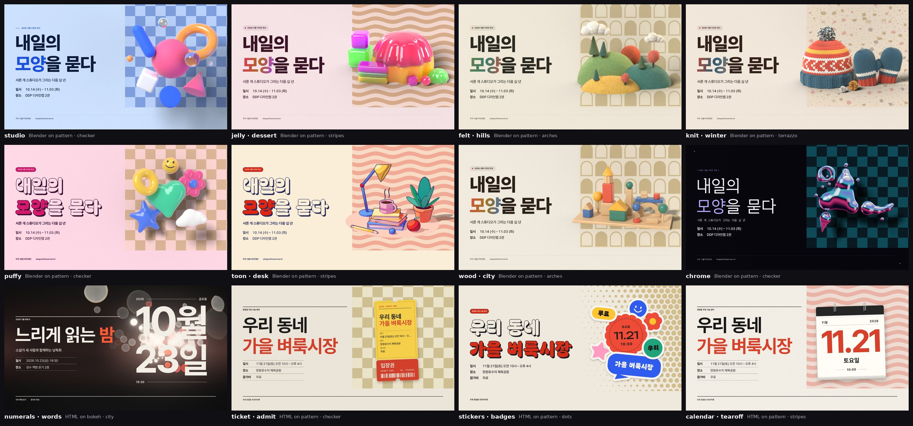
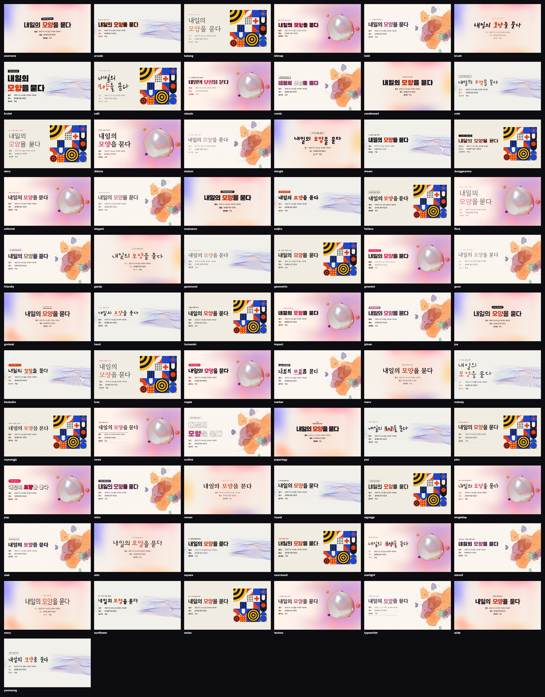
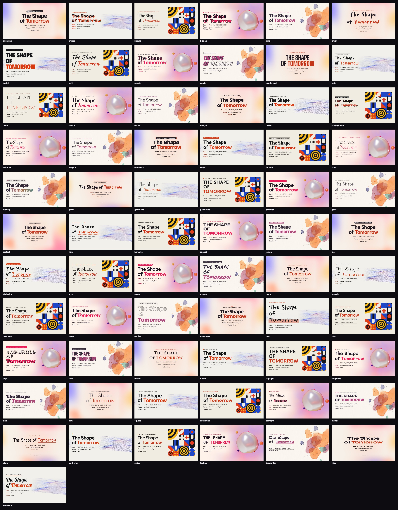
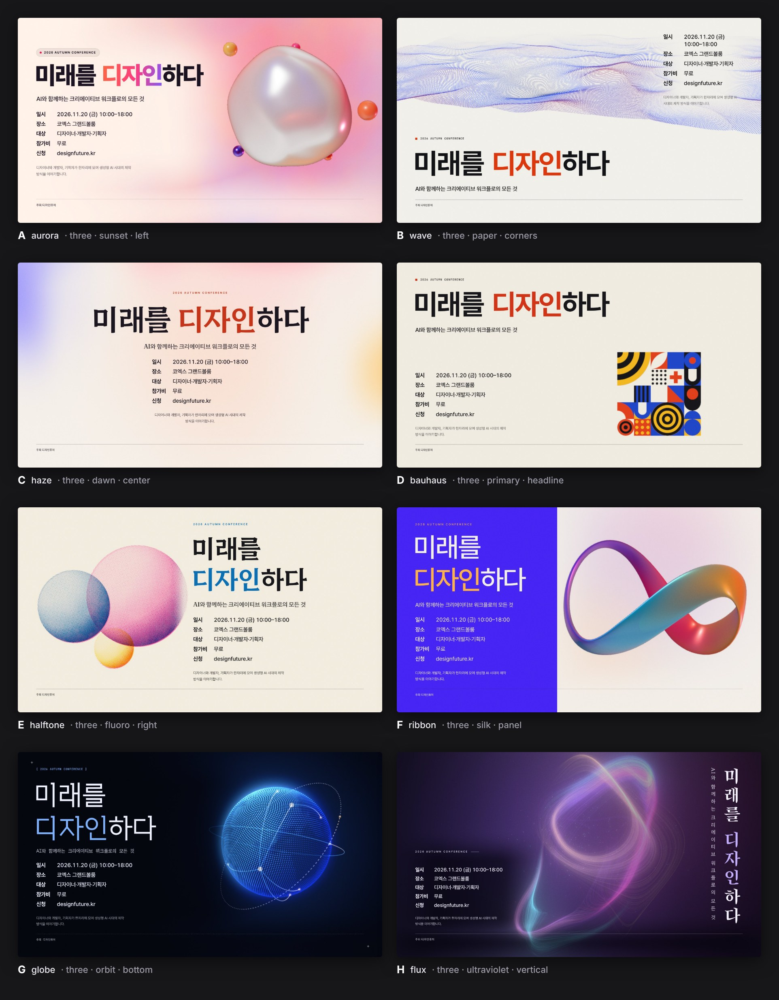
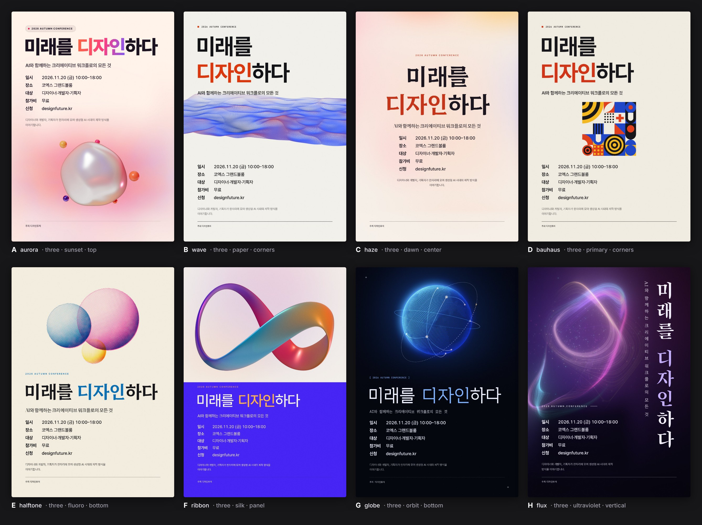
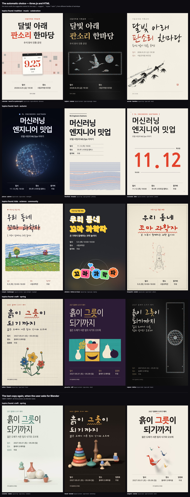

# Namok Poster

포스터에 들어갈 문구를 주면 **디자인이 서로 다른 A3 포스터 세 장을 완성본으로** 만들어 주는 Claude Code 스킬입니다.
스킬 이름은 `namokposter`입니다. 그림은 three.js와 HTML로 몇 초 만에 그리고, 글자는 헤드리스 Chromium에서
한글·영문 조판 규칙대로 얹습니다. 처음 부탁할 때 "블렌더 사용해서 만들어 줘"라고 하면 세 장 모두 Blender(Cycles)로 만듭니다.

- 설치 안내와 스타일 라이브러리: **https://namokposter.namok4.com**
- 버전 **1.0.0** · 버전마다 바뀐 내용은 [CHANGELOG.md](CHANGELOG.md), 버전별로 받는 곳은 [릴리스](https://github.com/hotjinnasim-code/NamokPoster/releases)
- 판형을 말하지 않으면 A3 세로(297×420 mm, 300 dpi, 3508×4961 px)로 만듭니다. 화면이나 발표용 가로 16:9(2K, 2560×1440), 4K, 다른 비율은 요청하면 됩니다.



위 포스터는 무엇을 그릴지 정해 주지 않고 행사 문구만 주고 받은 것입니다. 「한가위 달맞이 한마당」에는 달토끼와 감나무 가지와
한옥 지붕 위의 달을, 「Systems at Scale 2027」에는 서버 랙 통로와 불어나는 격자와 옛 공장을 구상해 코드로 직접 그렸습니다.
아래는 그런 그림을 만드는 기법, 곧 스타일 77가지입니다.



## 빠르게 시작하기

코딩을 몰라도 됩니다. 명령어를 직접 칠 일은 없고, Claude에게 말로 부탁하면 됩니다.
그림과 영상으로 보는 안내는 **https://namokposter.namok4.com** 에 있습니다.

### 1. 설치

1. Claude 앱을 열고 **Code** 탭으로 갑니다. (터미널에서 Claude Code를 쓰고 있다면 그대로 써도 됩니다.)
2. 아래 문장을 그대로 붙여 넣고 보냅니다.

```text
https://github.com/hotjinnasim-code/NamokPoster 이 스킬을 설치해 줘
```

Claude가 저장소를 받아 스킬을 설치하고, 필요한 프로그램도 준비합니다. 도중에 허락을 구하면 허용을 누르세요.
처음 한 번은 몇 분 걸립니다(포스터에 글자를 얹는 데 쓰는 브라우저를 내려받습니다).
잘 안 되면 "namokposter 환경 점검해 줘"라고 말하면 무엇이 빠졌는지 알려 줍니다.

**모델은 Opus 이상을 권장합니다.** 문구에서 주제를 읽고, 제목을 뜻 단위로 나누고, 어울리는 스타일과 배치를 고르는 일을
모델이 합니다. 모델이 좋을수록 포스터가 좋아집니다. 입력창의 모델 선택에서 고르면 됩니다(터미널에서는 `/model`).

> 설치를 부탁받은 AI 에이전트는 [INSTALL.md](INSTALL.md)의 순서를 따르세요.

<details>
<summary>직접 설치하려면</summary>

저장소를 받아 스킬 폴더를 복사합니다.

```bash
git clone https://github.com/hotjinnasim-code/NamokPoster.git
```

```bash
cp -R NamokPoster/.claude/skills/namokposter ~/.claude/skills/
```

이 저장소를 Claude Code로 바로 열어도 됩니다. `.claude/skills/namokposter`가 프로젝트 스킬로 잡힙니다.

| 준비물 | 용도 | 준비 |
|---|---|---|
| Node 18+ | 전체 | — |
| Playwright + Chromium | 글자 조판과 three.js · HTML 스타일. 모든 포스터에 필요합니다 | 스킬 폴더에서 `npm install --no-save playwright && npx playwright install chromium` |
| Blender 4.2+ 또는 `bpy` 모듈 | Blender 스타일. "블렌더 사용해서"라고 부탁할 때만 필요합니다 | Blender 설치, 또는 `node scripts/doctor.mjs --install-blender` |

준비가 됐는지는 스킬에 든 점검 스크립트로 확인합니다.

```bash
node ~/.claude/skills/namokposter/scripts/doctor.mjs
```

</details>

### 2. 첫 포스터

행사 내용을 평소 말하듯 알려 주면 됩니다.

```text
한가위 달맞이 한마당 포스터 만들어 줘. 9월 15일 수요일 오후 5시부터 9시까지 달여울 한옥마을 마당에서 하고, 누구나 무료야.
```

몇 초 뒤 디자인이 다른 A3 포스터 세 장이 나옵니다. 세 장 모두 바로 쓸 수 있는 완성본입니다.

**원하는 것이 있으면 처음부터 같이 말합니다.** 크기와 비율, 색, 그림을 만드는 기법, 그림에 담을 것, 글꼴, 더 넣을 글을 처음 부탁할 때 말하면 첫 세 장부터 그대로 나옵니다. 말하지 않은 것만 스킬이 정합니다. 크기를 말하지 않으면 A3 세로입니다.

```text
한가위 달맞이 한마당 포스터를 인스타용 4:5로 만들어 줘. 9월 15일 수요일 오후 5시부터 9시까지 달여울 한옥마을 마당에서 하고, 누구나 무료야. 부제는 '온 동네가 함께 보는 보름달'로 넣어 줘.
```

아래 말은 처음 부탁할 때 넣어도 되고, 받은 뒤에 이어서 해도 됩니다.

| 이렇게 말하면 | 이렇게 됩니다 |
|---|---|
| "가로 16:9로", "발표 화면용으로" | 2K 가로형(2560×1440)으로 조판합니다 |
| "인스타용 4:5로", "스토리용 9:16으로", "A3와 16:9 둘 다" | 그 비율에 맞춰 조판합니다. 여러 크기를 한 번에 뽑을 수 있습니다 |
| "인쇄소에 맡길 PDF로" | 글자가 벡터로 남는 PDF, 재단 여백 3mm |
| "원하는 색 #0052ff로", "따뜻한 가을 색으로" | 세 장 모두 그 색으로 |
| "수묵으로", "종이 오리기 기법으로" | 그 기법으로 그립니다 |
| "달이 꼭 들어가게", "사람은 빼고" | 그림에 담는 것을 그렇게 정합니다 |
| "손글씨 느낌으로", "G마켓 산스로", "이 글꼴 파일로" | 그 글씨로 조판합니다. 이름을 댄 글꼴이나 건넨 파일을 그대로 씁니다 |
| "부제는 …", "아래에 주최와 누리집 주소를 넣어 줘", "QR 코드도" | 그 글과 요소를 넣습니다 |
| "블렌더 사용해서 만들어 줘" | 세 장 모두 Blender로 만듭니다(장당 몇 분, Blender 필요) |

받은 뒤에는 한 장만 골라 고칠 수도 있습니다. "B에서 제목을 더 크게"처럼 말하면 그 한 장만 고쳐서 다시 만듭니다.

문구를 항목별로 정해 주고 싶으면 이렇게 적어도 됩니다.

```text
포스터 만들어 줘.
eyebrow: 2026 AUTUMN CONFERENCE
title: 미래를 디자인하다
subtitle: AI와 함께하는 크리에이티브 워크플로의 모든 것
일시: 2026.11.20 (금) 10:00–18:00
장소: 눈모루 컨벤션 그랜드볼룸
참가비: 무료
footer: 주최 디자인퓨처 / designfuture.kr
```

### 3. 블렌더 사용해서 만들기 (선택)

행사 내용을 말할 때 "블렌더 사용해서 만들어 줘"라고 덧붙이면 처음부터 Blender로 만든 포스터 세 장이 나옵니다. 클레이·유리·펠트 같은 재질과 빛을 실제로 계산해서 그립니다.

```text
한가위 달맞이 한마당 포스터 블렌더 사용해서 만들어 줘. 9월 15일 수요일 오후 5시부터 9시까지 달여울 한옥마을 마당에서 하고, 누구나 무료야.
```

이때만 Blender가 필요합니다. 준비하는 방법은 둘 중 하나입니다.

- **말로 맡기기** — Claude에게 "namokposter에서 블렌더도 쓸 수 있게 준비해 줘"라고 합니다.
- **직접 설치하기** — [blender.org/download](https://www.blender.org/download/)에서 받아 설치합니다(무료, 4.2 이상).
  Mac은 받은 파일을 열어 Blender를 응용 프로그램 폴더로 끌어 놓고, Windows는 설치 파일을 실행해 안내대로 누르면 됩니다.
  설치한 Blender는 스킬이 알아서 찾습니다.

## 무엇을 하나요

- **입력** — `eyebrow`, `title`, `subtitle`, 행사 정보(`meta`: 일시·장소·대상·참가비·신청 …), `body`, `footer`
  + 선택 요소(CTA 버튼, 배지, 로고, 후원사 로고, QR 코드, 임의 HTML 슬롯)
- **출력** — 디자인이 다른 완성본 3장(A3 300 dpi PNG, 필요하면 JPG·PDF) + 비교용 콘택트 시트 + 검수 리포트
- **내용에 맞는 그림** — 포스터 내용을 읽고 그림에 담을 것(모티프)을 새로 구상한 뒤 그 그림을 직접 그립니다.
  재즈 페스티벌이면 색소폰이나 야외무대, 북페어면 책 더미처럼 그 행사에서 나온 그림입니다. 꼭 눈에 보이는 물건일 필요는 없습니다.
  행사의 리듬이나 분위기를 옮긴 추상적인 그림도 모티프가 됩니다. 세 장은 서로 다른 것을 그립니다.
- **스타일 77종** — 종이 부조·리노컷·수묵·조각보·자개·엠보싱·리브 유리·노선도·펠트·네온 등 그림을 만드는 기법입니다.
  기본 세트 54종(three.js 44, HTML 10)과 Blender 세트 23종으로 나뉩니다.
  스타일마다 팔레트 5개가 있고 브랜드 컬러를 그대로 넣을 수 있습니다.
- **타이포그래피 테마 67종** — 한글·영문 서체 86종을 짝지은 67가지 목소리. 어떤 스타일과도 조합됩니다. 들어 있는 서체는 모두 상업적으로 쓸 수 있고 널리 쓰이는 글꼴입니다. 쓰고 싶은 글꼴이 있으면 이름을 말하거나 글꼴 파일을 건네면 됩니다. 말하지 않으면 내장 글꼴만 씁니다.
- **기본은 three.js와 HTML** — 판화·회화·공예·제너러티브·빛은 three.js, 날짜·장소·글자·벡터 그래픽은
  HTML이 그립니다(문구에서 날짜·장소·제목을 읽어 그림으로 만듭니다). 스타일에 따라 하나만 쓰기도 하고,
  HTML 그래픽을 three.js 배경 위에 얹어(`ground`) 둘을 함께 쓰기도 합니다.
- **Blender는 요청할 때만** — "블렌더 사용해서"라고 하거나 클레이·유리·펠트 같은 3D 재질을 지목하면
  세 장 모두 Blender 스타일로 만듭니다. Blender 피사체를 패턴·그라데이션 배경 위에 얹는 조합도 됩니다.
- **주제 인식** — 문구에서 주제를 읽어 어울리는 기법·서체·팔레트를 알려 줍니다. 그림에 담을 것은 Claude가 내용에서 구상합니다.
- **레이아웃 13종 + 좌우 반전** — 구조가 다른 5개 군: 나란히(`left` · `right` · `side`), 위아래(`top` · `bottom` · `band`),
  펼침(`strip` · `corners` · `headline` · `baseline`), 중심축(`axis` · `center`), 세로쓰기(`vertical`).
  이름에 `-mirror`를 붙이면 좌우가 바뀝니다. 카피를 먼저 조판해 크기를 잰 뒤 글자가 실제로 차지한 자리를 피해
  가장 넓은 빈 곳에 그림을 배치하고, 자동 선택은 세 장에 서로 다른 구조의 레이아웃을 배정합니다.
- **판형** — 기본은 `a3`(세로, 3508×4961)입니다. 화면·슬라이드·발표·유튜브용이라고 하면 `2k`(가로 16:9, 2560×1440)로 만듭니다.
  그 밖에 `4k`(요청 시), `fhd`, `a0`–`a5`, `instagram-post`(4:5), `story`(9:16), `square`, `web-banner`, 임의 비율·픽셀이 됩니다.
  화면용 판형은 2K급이 기본이고 `"resolution": "4k"`를 주면 4K급으로 커집니다.
  `"format": ["a3", "2k"]`처럼 여러 판형을 한 번에 뽑을 수 있고, 인쇄용 재단 여백(`bleed`)과 PDF 출력을 지원합니다.
- **제목 줄바꿈** — 제목이 "파랑곶 서핑 / 페스티벌"처럼 이름 한가운데서 끊기면 "서핑"이 장소에 붙은 것처럼 읽힙니다.
  그래서 제목은 한 덩어리로 읽히는 단위를 `|`로 나눠 적습니다(`파랑곶 | *서핑* 페스티벌`). 이 표시는 인쇄되지 않고,
  줄은 단위 사이에서만 바뀝니다. 한 단위가 좁은 글줄에 안 들어가면 글자를 조금 줄이고, 그래도 잘라야 하면 경고를 냅니다.
  표시가 없으면 스스로 읽습니다. 앞의 연도·회차와 뒤의 단계·차수는 떼어 놓고, 한글 제목은 마지막 두 낱말을 이름으로 묶습니다.
  세 낱말 이상인 제목에는 표시를 붙이는 것이 가장 정확합니다.
- **300 dpi 기본** — 인쇄 판형은 A5부터 A0까지 모두 300 dpi로 렌더합니다(다른 해상도는 `{"preset": "a1", "dpi": 150}`처럼 요청할 때만).
  화면용 판형을 포함한 모든 PNG·JPG·PDF에 300 dpi 정보가 기록되어, 파일을 열면 실제 인쇄 크기로 열립니다.
- **자동 검수** — 카피 넘침, 안전 여백 이탈, 배경 대비 부족, 글리프 누락을 실제 픽셀로 측정해 알려 줍니다.
- **확장** — 원하는 피사체는 장면 파일 하나(`build(ctx)`)만 쓰면 되고, 카메라·배치·팔레트·렌더 설정은
  스킬이 처리합니다. 스톡 스타일에 없는 룩은 `references/style-recipes.md`의 레시피를 참고합니다.

## 기본 세트와 Blender 세트

어떤 엔진으로 세 장을 만들지는 요청이 정합니다.

| 요청 | 세 장을 만드는 엔진 | 걸리는 시간(A3 300 dpi 기준) |
|---|---|---|
| 엔진을 따로 말하지 않은 요청 | **three.js와 HTML** — 스타일에 따라 하나만 쓰거나, HTML 그래픽을 three.js 배경 위에 얹습니다 | 장당 수 초(three.js는 길어야 10초 안팎, HTML은 1초 안팎) |
| "블렌더 사용해서", "클레이 느낌으로", "유리 재질로", "3D 커피잔을 메인으로" | **Blender** — 단독으로 쓰거나, Blender 피사체를 three.js·HTML 배경 위에 얹습니다 | 장당 약 10분(4코어 CPU 기준, GPU는 몇 배 빠름). 2K는 2–3분 |

Blender 세트도 처음부터 A3 완성본으로 만듭니다. GPU가 없는 컴퓨터에서는 세 장에 30분쯤 걸리므로, 시작하기 전에 걸리는 시간을 알려 줍니다.
기본 세트를 전달할 때는 Blender 세트도 요청할 수 있다는 점을 한 줄로 알려 줍니다. 엔진마다 맡는 일은 이렇습니다.

| 포스터가 말하려는 것 | 쓰는 엔진 | 걸리는 시간(A3 300 dpi 기준) |
|---|---|---|
| 판화·회화·공예 기법, 일러스트, 제너러티브, 빛과 유리, 종이의 두께 | **three.js** | 장당 수 초 |
| 기억할 날짜나 장소 하나, 정보 위주, 글자가 주인공인 그래픽 | **HTML** — DOM·SVG로 그려 벡터 그대로 PDF에 들어가고, 문구의 날짜·장소·제목으로 그림을 만듭니다 | 즉시 |
| 글자 그래픽을 더 풍부한 바탕에 두고 싶을 때 | HTML 피사체 + three.js가 그린 **배경** | 수 초 |
| 실제 재질·빛, 손에 잡힐 듯한 입체 (요청 시) | **Blender** (Cycles 패스 트레이싱) | 장당 약 10분(2K는 2–3분) |
| 3D 피사체를 스튜디오가 아닌 그래픽 세계에 두고 싶을 때 (요청 시) | Blender 피사체 + 다른 엔진이 그린 **배경** | Blender 컷아웃은 일반 렌더의 1.5–2배(그림자를 따로 계산) |

**HTML 스타일** — `numerals`(날짜를 큰 숫자로 — 월·일을 항상 함께: `11.15`, `11`/`15`, `11월`/`15일`) · `calendar`(월력·일력·주간) ·
`swiss`(규칙으로 지은 기하 도형 — 호·막대·점·사선) · `ticket`(입장권·패스·영수증) · `stamp`(우표와 소인) ·
`transit`(장소를 노선도·지도로) · `stickers`(다이컷 스티커) · `screen`(플랫 UI 화면) ·
`marquee`(제목을 반복한 글자 무늬) · `pattern`(체커·물결·도트·테라초·아치·모눈).
날짜가 있어야 성립하는 스타일(`numerals`, `calendar`)은 문구에 날짜가 있을 때만 자동 추천됩니다.



**배경 위에 얹기(`ground`)** — 스펙의 포스터 항목에 `ground`를 적으면 그 스타일을 배경으로 깔고, 원래 스타일은 그 위에
피사체로 올립니다. HTML과 three.js를 한 장에서 함께 쓰는 방법이 이것입니다. 배경색은 그 포스터의 팔레트에서 뽑은
옅은 색조가 기본이고, `"soft": false`를 주면 팔레트 색 그대로 진하게 씁니다. 자동 선택은 스타일이 확인해 둔
조합이 있을 때 세 장 중 한 장에만 배경을 붙입니다.

```json
{ "style": "numerals", "palette": "ink", "ground": "bokeh" }
{ "style": "ticket", "ground": { "style": "pattern", "motif": "checker" } }
{ "style": "studio", "palette": "sky", "ground": "pattern" }
```



Blender 세트에서는 Blender 피사체를 투명 배경 + 그림자만 남긴 컷아웃으로 뽑아 같은 방식으로 얹습니다.



표의 ◆는 다른 배경 위에 얹을 수 있는 스타일, ▦는 배경이 되는 스타일입니다. 스타일마다 확인해 둔 조합은
`references/styles.md`에 있습니다.

## 스타일 77종

스타일은 **기법**입니다. 무엇을 그릴지(모티프)는 포스터마다 내용에서 새로 구상하고, 고른 기법으로 직접 그립니다.
표의 「기성 모티프」는 그 기법으로 미리 만들어 둔 예시입니다. 구상한 그림과 꼭 맞을 때만 그대로 씁니다.
표의 ◆는 다른 배경 위에 얹을 수 있는 스타일, ▦는 배경(`ground`)으로 깔 수 있는 스타일입니다.

<!-- styles:start -->
### 기본 세트 — three.js와 HTML (54종)

**종이와 공예**

| 스타일 | 기법 | 엔진 | 기성 모티프(예시) |
|---|---|---|---|
| `papercut` | 겹겹이 오린 종이 부조 | three.js | strata, tide, canopy |
| `emboss` | 무지 엠보싱과 박 | three.js | monogram, pattern, crest |
| `collage` | 찢고 오린 종이 콜라주 | three.js | abstract, landscape, city |
| `bojagi` | 조각보 | three.js | patchwork, window, landscape |
| `najeon` | 나전칠기(자개) | three.js | cranes, blossom, lattice, waves |
| `stitch` | 자수 | three.js | flowers, sampler, borders |
| `mosaic` | 타일 모자이크 | three.js | waves, arches, bands |
| `stainedglass` | 스테인드글라스 | three.js | landscape, flowers, geometric |

**인쇄와 회화**

| 스타일 | 기법 | 엔진 | 기성 모티프(예시) |
|---|---|---|---|
| `halftone` ▦ | 리소 망점 인쇄 | three.js | — |
| `linocut` | 리노컷 판화 | three.js | hills, waves, botanical, rooftops |
| `gouache` ◆ | 과슈 색종이 오리기 | three.js | fronds, still, shore |
| `crayon` | 크레용·오일파스텔 | three.js | landscape, stilllife, city, scribble |
| `watercolor` ▦ | 수채 | three.js | — |
| `sumuk` | 수묵 | three.js | mountains, bamboo, plum, strokes |
| `cyanotype` | 청사진 인화(포토그램) | three.js | botanical, objects, shapes, algae |
| `marble` ▦ | 마블링 | three.js | — |
| `layers` | 평면 레이어 실루엣 | three.js | mountains, sea, city |
| `airbrush` | 레트로 에어브러시 | three.js | planet, moons, orbits |

**그래픽 시스템**

| 스타일 | 기법 | 엔진 | 기성 모티프(예시) |
|---|---|---|---|
| `bauhaus` ▦ | 기하 타일 | three.js | — |
| `memphis` ▦ | 멤피스 패턴 | three.js | confetti, stack, totem |
| `opart` | 옵아트 | three.js | sphere, wave, fold |
| `artdeco` | 아르데코 선 장식 | three.js | tower, arch, scallop |
| `guilloche` | 기요셰(지폐 세선 문양) | three.js | ribbon, medallion, frame |
| `contour` ▦ | 등고선 | three.js | mountain, coast, peak |
| `flowfield` ▦ | 흐름장을 따라 흐르는 띠 | three.js | bands, threads, eddy |
| `wave` ▦ | 도트 지형 | three.js | — |
| `haze` ▦ | 그레인 그라디언트 | three.js | — |
| `glyph` | 글자 조형(타이포 아트) | three.js | giant, grid, echo |

**디지털·빛·움직임**

| 스타일 | 기법 | 엔진 | 기성 모티프(예시) |
|---|---|---|---|
| `flux` | 네온 광선 | three.js | — |
| `plexus` | 노드·선 네트워크 | three.js | sphere, torus, wave, constellation |
| `globe` | 도트 지구본 | three.js | — |
| `pointcloud` | 점묘 입체(포인트 클라우드) | three.js | knot, terrain, vase, shell |
| `blueprint` | 설계 도면 | three.js | tower, gear, rocket, chair |
| `synthwave` | 신스웨이브 | three.js | sun, city, canyon |
| `glitch` | CRT·VHS 글리치 | three.js | solids, horizon, shapes |
| `pixel` | 디더 픽셀아트 | three.js | — |
| `bokeh` ▦ | 보케 조명 | three.js | city, string, lantern, glitter |
| `caustics` | 물빛(코스틱) | three.js | pool, sand, gel |
| `fluted` ▦ | 리브 유리 너머의 빛 | three.js | orb, dusk, bloom |
| `inkdrop` | 물속 잉크 | three.js | plume, drop, duet, band |
| `liquid` ▦ | 리퀴드 그라디언트 | three.js | mass, rise, wave, drip |
| `aurora` | 진주빛 그라디언트 블롭 | three.js | — |
| `ribbon` | 새틴 리본 | three.js | — |
| `turing` ▦ | 반응–확산 무늬 | three.js | — |

**글자와 벡터 그래픽(HTML)**

| 스타일 | 기법 | 엔진 | 기성 모티프(예시) |
|---|---|---|---|
| `numerals` ◆ | 큰 숫자 — 날짜를 그림으로 | HTML | date, stack, words |
| `calendar` ◆ | 달력(월력·일력·주간) | HTML | month, tearoff, week |
| `swiss` ◆ | 스위스 기하 그래픽 | HTML | arcs, bars, dots, diagonal |
| `ticket` ◆ | 티켓·패스·영수증 | HTML | admit, pass, receipt |
| `stamp` ◆ | 우표와 소인 | HTML | single, sheet, airmail |
| `transit` ◆ | 노선도로 그린 장소 | HTML | metro, route, blocks |
| `stickers` ◆ | 다이컷 스티커 | HTML | badges, labels, letters |
| `screen` ◆ | 플랫 UI 화면 | HTML | windows, chat, player, search |
| `marquee` ▦ | 제목을 반복한 글자 무늬 | HTML | rows, tilt, tape, steps |
| `pattern` ▦ | 플랫 벡터 패턴 | HTML | checker, stripes, dots, terrazzo, arches, grid |

### Blender 세트 — '블렌더 사용해서'라고 요청했을 때 (23종)

**종이와 공예**

| 스타일 | 기법 | 엔진 | 기성 모티프(예시) |
|---|---|---|---|
| `paper` ◆ | 종이 오림 | Blender | — |
| `origami` ◆ | 종이접기 | Blender | cranes, boats, peaks, relief |

**부드러운 촉감의 3D**

| 스타일 | 기법 | 엔진 | 기성 모티프(예시) |
|---|---|---|---|
| `studio` ◆ | 클레이 정물 | Blender | — |
| `puffy` ◆ | 부풀린 유광 토이 | Blender | — |
| `felt` ◆ | 양모 펠트 | Blender | hills, fruit, pebbles |
| `knit` ◆ | 니트(뜨개) | Blender | winter, bunting, shapes |
| `jelly` ◆ | 반투명 젤리·왁스 | Blender | dessert, gummies, candles, hills |
| `wood` ◆ | 나무 블록·목선반 | Blender | city, turned, hills |
| `softscape` | 파스텔 3D 풍경 | Blender | lake, dunes, room, clouds |

**재질과 빛(3D)**

| 스타일 | 기법 | 엔진 | 기성 모티프(예시) |
|---|---|---|---|
| `prism` ◆ | 검은 배경의 유리 링 | Blender | — |
| `chrome` ◆ | 액체 크롬 | Blender | — |
| `glass` ◆ | 반투명 유리 패널 | Blender | cards, discs, arch |
| `foil` ◆ | 홀로그램 포일 | Blender | balloons, sheet, ribbons |
| `metal` ◆ | 가공 금속 | Blender | dial, rods, blocks |
| `stone` ◆ | 대리석과 금 | Blender | podium, balance, arch |
| `ceramic` ◆ | 유약 도자 | Blender | vases, table, tiles |
| `neon` | 네온 사인 | Blender | arcs, icons, frame |
| `monolith` ◆ | 석고 아치 | Blender | — |
| `fabric` ◆ | 드레이프 천(실크·벨벳) | Blender | drape, curtain, flow |

**일러스트풍 3D**

| 스타일 | 기법 | 엔진 | 기성 모티프(예시) |
|---|---|---|---|
| `toon` ◆ | 셀 셰이딩 툰 | Blender | desk, hills, blocks |
| `lowpoly` ◆ | 로우폴리 | Blender | island, peaks, berg, rocket, forms |
| `isometric` ◆ | 아이소메트릭 미니어처 | Blender | room, shop, stage |
| `voxel` ◆ | 복셀 | Blender | island, city, heart |
<!-- styles:end -->

## 타이포그래피 테마 67종

각 테마는 포스터·북 디자인의 한 전통을 따르고, 한글 서체와 라틴 서체를 짝지어 씁니다. 글꼴은 대부분 OFL 공개 라이선스이고, 둥근모꼴은 퍼블릭 도메인, 여기어때 잘난체·에스코어 드림·이사만루·메이플스토리는 고치지 않은 파일의 재배포를 허락한 원저작자의 조건으로 들어 있습니다.

- **깔끔한 산세리프** — `bold` · `friendly` · `swiss` · `grotesk`(스위스 네오그로테스크) · `geometric`(바우하우스 기하) · `elegant` · `dodum`(고운돋움) · `humanist`(나눔고딕) · `square`(나눔스퀘어 네오) · `round`(나눔스퀘어라운드) · `plex`(IBM Plex) · `sunflower`(탈네모꼴 모던) · `slim`(가는 탈네모꼴) · `gmarket`(G마켓 산스, 꽉 찬 기하 고딕) · `paperlogy`(페이퍼로지, 발표 자료 고딕) · `dream`(에스코어 드림, 직사각형 제목 고딕)
- **강한 디스플레이** — `impact` · `brutal` · `condensed`(영화 포스터 고딕) · `wide`(확장 그로테스크) · `slab` · `fatface`(굵은 견출명조) · `stencil` · `pop` · `comic`(만화 표지 글씨) · `jua`(주아) · `outline` · `jalnan`(여기어때 잘난체) · `anemone`(카페24 아네모네) · `ssurround`(카페24 써라운드, 썸네일 제목) · `esamanru`(이사만루, 야구장 글씨) · `maple`(메이플스토리, 게임 제목)
- **세리프·문학** — `editorial` · `myeongjo`(송명) · `batang`(고운바탕) · `maru`(마루 부리) · `garamond` · `didone`(패션지) · `news`(신문 제목) · `roman`(비문 대문자) · `flora`(헤어라인 세리프) · `luxe` · `deco`(아르데코)
- **손글씨·붓글씨** — `hand` · `pen`(펜글씨) · `story`(또박또박한 펜글씨) · `melody`(가늘고 동글한 손글씨) · `gamja`(크레파스 글씨) · `dongle`(둥근 어린이 글씨) · `singleday`(각진 장난 글씨) · `marker`(매직) · `brush`(붓글씨) · `calli`(붓펜 캘리그라피) · `starlight`(카페24 빛나는별, 굵은 마커) · `goun`(카페24 고운밤, 가는 밤 손글씨) · `kkubulim`(꾸불림체, 꼬불꼬불한 손글씨)
- **간판** — `retro`(뉴트로) · `signage`(70–80년대 아크릴 간판) · `yeonsung`(붓으로 쓴 간판, 연성체) · `euljiro`(을지로체, 페인트 간판 레터링) · `classic`(카페24 클래식타입, 옛 간판과 영화 제목)
- **기계** — `techno` · `typewriter` · `bitmap`(도트) · `arcade` · `cute`(게임기 대화창 글씨) · `dunggeunmo`(둥근모꼴, PC통신 비트맵)

들어 있는 글꼴은 두 가지를 확인하고 넣었습니다. 상업적으로 쓸 수 있고 스킬에 넣어 다시 배포해도 되는 라이선스인지(SIL OFL 1.1, Apache 2.0, 퍼블릭 도메인, 또는 고치지 않은 파일의 재배포를 허락한 원저작자 조건), 실제로 널리 쓰이는지(라틴은 Google Fonts 인기 순위 500위 안, 한글은 눈누 조회순 100위 안이거나 인기순 100위 안이면서 조회수 10만 이상, 또는 Google Fonts 한글 글꼴의 위쪽 3분의 2, 나눔글꼴·Pretendard처럼 한국에서 널리 쓰이는 글꼴)입니다. 인기는 많지만 재배포를 막거나 상업 사용을 분명히 적지 않은 글꼴(어그로체, 쿠키런, 조선일보 글꼴 등)은 넣지 않았습니다. 글꼴마다의 근거는 [`references/fonts.md`](.claude/skills/namokposter/references/fonts.md)에 있습니다.

Claude는 내장 테마로 포스터를 조판하고, 스스로 밖에서 글꼴을 찾지 않습니다. 쓰고 싶은 글꼴이 있으면 이름을 말하거나 글꼴 파일을 건네면 됩니다. 건넨 파일과 이 컴퓨터에 설치된 글꼴은 그대로 쓰고, Google Fonts에 있거나 원저작자가 자기 사이트에서 무료로 내주는 글꼴은 그곳에서만 받아 씁니다(`scripts/fonts.mjs`). 글꼴 라이선스는 사용자가 이미 갖고 있을 수 있으니 기준으로 막지 않습니다. 다만 유료 글꼴은 어디서도 받지 않고, 파일을 건네 달라고 한 뒤 그동안은 가장 가까운 내장 테마로 만듭니다. 받은 글꼴은 사용자 캐시 폴더에 두고, 어떤 글꼴을 어디서 가져왔고 라이선스가 무엇인지 포스터를 건넬 때 알려 줍니다.




## 조판 원칙

읽는 순서대로 위계를 잡습니다: **eyebrow → title → subtitle → 행사 정보 → 본문 문단 → footer**.

- **행사 정보는 본문입니다.** 일시·장소·대상·참가비·신청·문의는 footer의 작은 글씨가 아니라 제목 바로
  아래의 정보 표로 조판합니다. 항목 이름과 내용은 같은 크기(이름은 굵게)로 맞춥니다. footer에 섞여
  들어온 일시·장소 등은 자동으로 정보 표로 옮기고, footer에는 주최·후원·URL만 남깁니다.
- **여백은 넉넉하게.** 외곽 여백은 짧은 변의 7.5%, 인쇄 판형은 8.5%(A3 기준 25mm)이며 가로형은 좌우를
  1.2배 더 둡니다.
- **한글 조판** — 어절 단위 줄바꿈, 한글 전용 행간·자간, 한글·라틴 혼용 시 크기 보정, 가짜 이탤릭·볼드
  금지, 세로쓰기 지원.




## 내용에서 그림까지

포스터 한 장은 이 순서로 만듭니다.

1. **내용을 읽습니다.** 무슨 행사인지, 거기서 무엇을 보고 만지는지, 어디서 언제 하는지를 적습니다.
2. **모티프를 구상합니다.** 이 행사에서 나온 그림 세 가지를 정합니다. 그 물건 자체, 그 장소나 순간, 문구로 만든 그림, 행사의 리듬이나 분위기를 옮긴 추상처럼 서로 다른 것입니다.
3. **기법을 고릅니다.** 모티프마다 가장 잘 살릴 스타일을 정합니다. 세 장의 기법이 겹치지 않게 합니다.
4. **직접 그립니다.** 그 기법의 장면 코드를 가져와 모티프를 그려 넣고, 작게 렌더해 보며 고칩니다.

주제에 어울리는 기법·서체·팔레트·레이아웃은 스킬이 추천합니다. 문구에서 주제(음악·전통·테크·어린이·럭셔리 등 37종)를
읽고, 한글·영문 키워드와 날짜의 계절을 함께 봅니다.

```bash
node .claude/skills/namokposter/scripts/poster.mjs poster.json --suggest
```

```text
topics: tradition 41% (판소리, 전통, 추석) · music 27% (공연) · celebration 21% (한마당) · autumn 10% (가을)
  {"style":"calendar","motif":"tearoff","type":"editorial","palette":"almanac","layout":"corners","ground":{"style":"pattern","motif":"grid"}}
  {"style":"najeon","motif":"cranes","type":"myeongjo","palette":"black","layout":"bottom"}
  {"style":"sumuk","motif":"bamboo","type":"luxe","palette":"hanji","layout":"right"}
```

추천에 함께 나오는 모티프는 기성 모티프입니다. `"styles": "auto"`는 이 추천의 앞 3개를 그대로 렌더하는 수동 실행용 경로이고,
Claude가 포스터를 만들 때는 모티프를 내용에서 구상합니다. 추천의 세 장은 기법 계열이 겹치지 않게 고릅니다
(공예·판화 하나, 제너러티브·빛 하나, 문구로 만든 그래픽 하나 식). 스타일이 확인해 둔 조합이 있으면 세 장 중
한 장에 배경(`ground`)을 붙이기도 합니다. `--blender`를 주면 추천이 Blender 스타일로만 나옵니다. 주제별 근거는
[`references/topic-guide.md`](.claude/skills/namokposter/references/topic-guide.md)에 있습니다.



## 직접 실행

Claude Code 없이 스크립트만 돌릴 수도 있습니다.

```bash
node .claude/skills/namokposter/scripts/poster.mjs poster.json --out poster-out
```

```json
{
  "content": {
    "eyebrow": "2026 Autumn Conference",
    "title": "미래를 *디자인*하다",
    "subtitle": "AI와 함께하는 크리에이티브 워크플로의 모든 것",
    "meta": [
      { "label": "일시", "value": "2026.11.20 (금) 10:00–18:00" },
      { "label": "장소", "value": "눈모루 컨벤션 그랜드볼룸" },
      { "label": "참가비", "value": "무료" }
    ],
    "footer": ["주최 디자인퓨처", "designfuture.kr"]
  },
  "format": ["a3", "2k"],
  "drafts": [
    { "style": "papercut", "motif": "strata", "type": "editorial" },
    { "style": "linocut", "motif": "rooftops", "type": "slab", "layout": "band" },
    { "style": "swiss", "motif": "arcs", "type": "grotesk", "layout": "corners" }
  ]
}
```

`format`을 빼면 A3 세로 한 가지만 만듭니다. `drafts`를 빼면 문구에 맞는 세 장을 알아서 고릅니다. `"blender": true`(또는 `--blender`)를 주면 그 세 장이
Blender 스타일이 됩니다. `--quality draft`(빠른 확인) · `--format a3` · `--formats png,pdf` · `--only B` ·
`--list-styles` 등의 옵션은 [`references/spec.md`](.claude/skills/namokposter/references/spec.md)에 있습니다.

## 알아 둘 것

폰트(한글·영문 86종)와 three.js는 스킬에 들어 있어 렌더링 중 네트워크가 필요 없습니다.
네트워크를 쓰는 때는 사용자가 말한 글꼴을 받아 올 때뿐입니다.
용량을 줄이려고 폰트 팩(`assets/fonts-extra`, 약 62 MB)을 빼고 설치하면 기본 서체만으로 완성되는 테마 8종
(`bold` · `brutal` · `editorial` · `elegant` · `friendly` · `impact` · `outline` · `swiss`)을 쓰고, 나머지 테마를 지정하면
대체 서체로 조판된다는 안내가 나옵니다.

렌더 시간은 three.js 스타일이 장당 몇 초(A3에서도 10초 안팎), HTML 스타일이 1초 안팎입니다. Blender 스타일은 4코어 CPU 기준으로
기본 판형인 A3(300 dpi)에서 장당 약 10분, 배경 위 컷아웃은 약 18분입니다. 2K 한 장은 약 2–3분, 4K는 약 3–5분이고
반투명 `jelly`와 천 시뮬레이션 `fabric`은 그 두 배 안팎입니다. GPU가 있으면 자동으로 쓰고 몇 배 빨라집니다.
`--quality draft`는 3D 층을 절반 해상도로 그리는 시험용 옵션입니다. 직접 만든 장면을 다듬을 때 쓰고, 결과물로 내놓지는 않습니다.

## 폴더 구조

```
.claude/skills/namokposter/   스킬 본체. 이 폴더만 복사하면 설치됩니다
├── SKILL.md                  작업 절차(스킬 본문)
├── VERSION                   이 스킬의 버전
├── scripts/
│   ├── poster.mjs            스펙 → 포스터 렌더 CLI
│   ├── fonts.mjs             사용자가 요구한 글꼴 받기·건넨 파일과 설치된 글꼴로 테마 만들기
│   ├── doctor.mjs            환경 점검 · bpy 설치
│   ├── lib/                  스펙 정규화, 주제 판별, 색, 브라우저, Blender 실행
│   └── blender/              render.py, common.py(장면 헬퍼)
├── assets/
│   ├── styles/<id>/          style.json · scene.js|py (아트 스타일과 모티프; three.js · HTML · Blender)
│   ├── families.json         기법 계열과 스타일 순서, 짧은 이름
│   ├── topics.json           주제 37종: 키워드·추천 스타일·서체·팔레트
│   ├── themes/<id>.css       타이포그래피 테마
│   ├── web/                  조판·합성 페이지, three.js 러너, 장면 라이브러리, 문구 읽기(날짜 인식)
│   ├── fonts/, fonts-extra/  번들 폰트(OFL 등)
│   ├── fonts-catalog.json    글꼴 기준과, 밖에서 받아 올 수 있게 확인해 둔 글꼴 목록
│   └── vendor/               three.js 번들, QR 생성기(MIT)
├── references/               spec · styles · topic-guide · design-principles · custom-scenes · html-scenes · style-recipes · troubleshooting
└── evals/                    평가 케이스
INSTALL.md                    설치를 부탁받은 AI 에이전트가 따르는 순서
CHANGELOG.md                  버전마다 바뀐 내용
examples/                     이 문서에 쓰는 예시 이미지
```

이 저장소에는 정식으로 낸 버전만 올라옵니다. 버전마다 커밋이 하나씩 쌓이고, 바뀐 내용은 [CHANGELOG.md](CHANGELOG.md)에 있습니다.

## 라이선스

스킬의 코드와 문서는 [MIT 라이선스](LICENSE)입니다. 함께 들어 있는 폰트(OFL, 퍼블릭 도메인, 원저작자 조건)와 three.js · QR 생성기(MIT)의
라이선스는 [`THIRD-PARTY-NOTICES.md`](.claude/skills/namokposter/THIRD-PARTY-NOTICES.md)에 있습니다.
